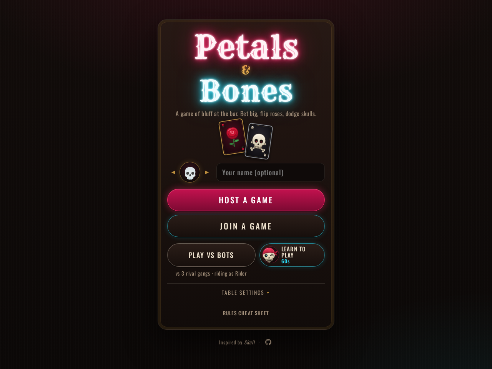

# Petals & Bones

A free, browser-based take on the bluffing party game *Skull*: lay your cards face down, bet on how many you can flip, and hope nobody hid a skull.

**Play: https://skull.xlobax.com**



## Inspired by Skull

Petals & Bones is a fan-made homage to **Skull**, designed by **Hervé Marly** and published by **Space Cowboys**. If you enjoy it, please [buy the real game](https://www.spacecowboys-games.com/game/skull/). It's even better around a real table.

## Features

- **Solo play vs bots**: take on 2 to 5 rival gangs, each bot with its own appetite for risk and bluffing.
- **Online multiplayer**: host a table and share a 4-letter code or link. Tables seat 3 to 6, and the host can fill empty seats with bots, set a turn timer (off, 20s, 30s or 60s) and list the table as Open or keep it Private. Refreshing or briefly losing your connection puts you back in your seat, and quick emoji reactions let you heckle the table.
- **Tutorial**: a guided, roughly 60-second "Learn to play" round, plus a rules cheat sheet you can open at any time.
- Works on phones and desktops. No accounts, no install.

## Local development

Requires Node.js 22 or newer.

```sh
npm install
npm run dev    # local server (wrangler dev) with the multiplayer backend
npm test       # unit tests (node --test)
```

The client is plain JavaScript with no build step: `index.html`, the CSS files and `src/` are served as static assets. The multiplayer server is a Cloudflare Worker with Durable Objects in `worker/`. Browser end-to-end checks live in `qa/`, which has its own `package.json` (Playwright).

## Deploys

Every push to `main` triggers GitHub Actions (`.github/workflows/ci.yml`), which runs the tests and then `wrangler deploy` to Cloudflare. Pull requests run the tests only. The deploy job needs two repository secrets, `CLOUDFLARE_API_TOKEN` and `CLOUDFLARE_ACCOUNT_ID`. [`scripts/setup-ci-secrets.sh`](scripts/setup-ci-secrets.sh) is an interactive wizard that walks you through creating and setting them. After a deploy, open tabs notice the new version when they reconnect, reload themselves and rejoin their seat.

## License

[MIT](LICENSE) © 2026 Alex Ferrer

## Disclaimer

Not affiliated with or endorsed by Space Cowboys, Asmodee, or Hervé Marly. Skull is a trademark of its respective owner.
